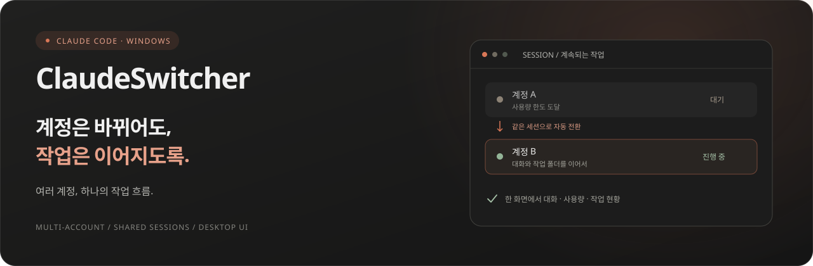
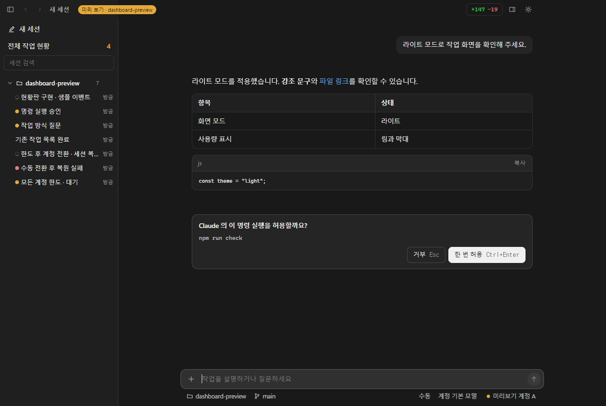
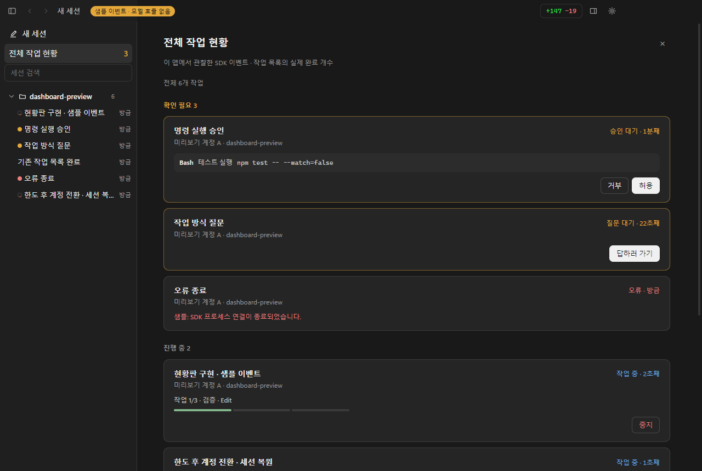

  

<h1 align="center">ClaudeSwitcher</h1>

Claude Code를 더 편하게 쓰는 Windows 데스크탑 앱

  
  
  

  <b><a href="https://github.com/hethek/claude-switcher-releases/releases/latest">Windows 최신 버전 다운로드 ↗</a></b>
  &nbsp; · &nbsp;
  <a href="https://github.com/hethek/claude-switcher-releases/releases">버전별 변경 내용</a>
  &nbsp; · &nbsp;
  <a href="#시작하기">설치 안내</a>

## 여러 계정을 하나의 작업 흐름으로

Claude Code를 채팅 화면에서 사용하고, 여러 Claude 계정을 오가며 같은 대화를 이어갑니다. 한 계정의 사용량을 다 쓰면 다음 계정으로 전환합니다. 모든 계정이 한도에 도달하면 초기화를 기다린 뒤, 사용 가능한 계정을 확인해 이어갈 수 있습니다.

| 계정과 사용량 | 대화와 작업 | 여러 세션 관리 |
| :--- | :--- | :--- |
| 계정별 로그인과 사용량 확인 | 파일·이미지 첨부와 Markdown 응답 | 폴더별 세션과 검색·고정·보관 |
| 한도 도달 시 자동 계정 전환 | 모델·생각 수준·권한 선택 | 다른 세션에서도 계속되는 작업 |
| 한도 초기화 후 자동 이어가기 | 변경 파일·diff·터미널·파일 보기 | 승인·질문·진행 상태를 모은 현황판 |

## 익숙한 채팅 화면, 필요한 작업 도구

<picture>
  <source media="(prefers-color-scheme: dark)" srcset="assets/chat-dark.png">
  <source media="(prefers-color-scheme: light)" srcset="assets/chat-light.png">
  
</picture>

앱에서 캡처한 샘플 화면입니다. 개인정보와 실제 계정 사용량을 포함하지 않습니다. 밝은·어두운 화면 모드를 지원합니다.

<b>전체 작업 현황 화면 보기</b>

승인이나 답변이 필요한 세션을 먼저 확인하고, 실행 중인 도구와 작업 목록을 볼 수 있습니다. 별도의 모델 호출 없이 앱이 관찰한 SDK 이벤트를 표시합니다.

## 시작하기

1. **[최신 릴리스](https://github.com/hethek/claude-switcher-releases/releases/latest)**에서 `ClaudeSwitcher-Setup-버전.exe`를 내려받아 실행합니다.
2. 설치 위치를 고르고 설치합니다. 기본 위치는 `%LOCALAPPDATA%\Programs\ClaudeSwitcher`입니다.
3. **Claude Code**를 준비합니다. 이미 설치되어 있으면 사용하고, 없으면 앱 첫 실행 안내에서 설치할 수 있습니다.
4. 사용할 Claude 계정에 각각 로그인하고, 작업 폴더를 선택해 대화를 시작합니다.

> Windows 10/11 **x64**용입니다. Claude 계정과 Claude Code 사용 권한이 필요하며, 각 계정의 사용량 한도가 적용됩니다.

## 자주 쓰는 조작

| 조작 | 동작 |
| :--- | :--- |
| `Enter` / `Shift+Enter` | 메시지 보내기 / 줄바꿈 |
| 응답 중 `Enter` / `Ctrl+Enter` | 다음 단계에서 읽도록 전달 / 턴 종료 후 보내기 |
| `Esc` | 진행 중인 응답 중지 또는 자동 이어가기 대기 취소 |
| `Ctrl+V` / 드래그 앤 드롭 | 이미지 붙여넣기 / 파일 첨부 |
| `Alt+←` / `Alt+→` | 열어 본 세션 뒤로 / 앞으로 |
| `Ctrl+Shift+S` | 세션 상세 패널 |
| 입력창의 `/` | 명령·스킬 목록 |

## 알아두면 좋은 점

<b>계정 자동 전환과 한도 초기화 대기</b>

자동 전환·자동 이어가기 설정으로 동작을 조절합니다. 모든 계정이 한도에 도달하면 초기화 시각까지 기다린 뒤 실제 사용량을 다시 확인합니다. 앱과 PC가 켜져 있어야 하며, 앱 종료 후에는 대기가 복원되지 않습니다. 초기화권을 자동으로 소모하지 않습니다.

<b>사용량 초기화권과 모델 안내</b>

계정 사용량 화면에서 보유 초기화권을 조회합니다. 서버가 사용 가능하다고 알려준 초기화권은 계정과 조건을 확인한 뒤 직접 사용할 수 있습니다. 모델별 안내와 혜택 문구도 서버 응답으로 표시합니다. 이 기능들은 비공개 계정 API를 사용하므로 서버 변경 시 조회나 사용이 제한될 수 있습니다.

<b>설정·기록 보관과 업데이트</b>

설정은 `%APPDATA%\claude-switcher`, 계정별 로그인 정보와 기록은 사용자 폴더의 `.claude-A`, `.claude-B` 등에 보관합니다. 제거·재설치 후에도 남으므로 새 PC에서는 계정에 다시 로그인해야 합니다.

설정 메뉴에서 앱의 새 버전을 확인하고 업데이트할 수 있습니다. 이 저장소는 설치 파일과 앱 업데이트를 제공하는 공개 배포 저장소입니다.

---

  ClaudeSwitcher는 Anthropic의 공식 제품이 아닌 독립 프로젝트입니다. 
  <a href="https://github.com/hethek/claude-switcher-releases/releases/latest">다운로드</a> ·
  <a href="https://github.com/hethek/claude-switcher-releases/releases">릴리스 기록</a>

